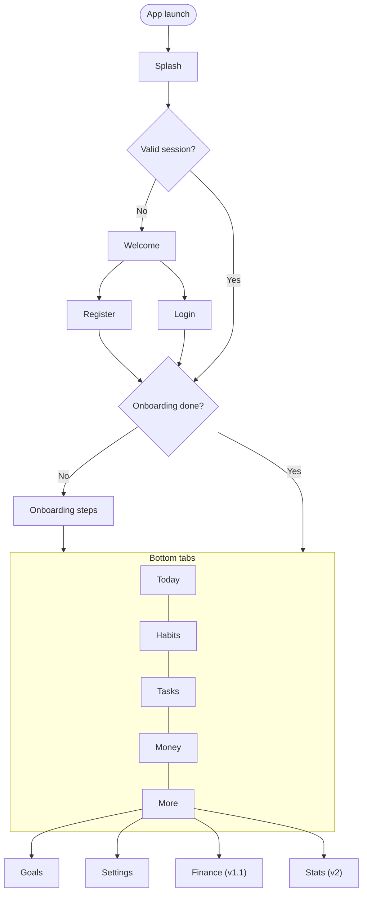
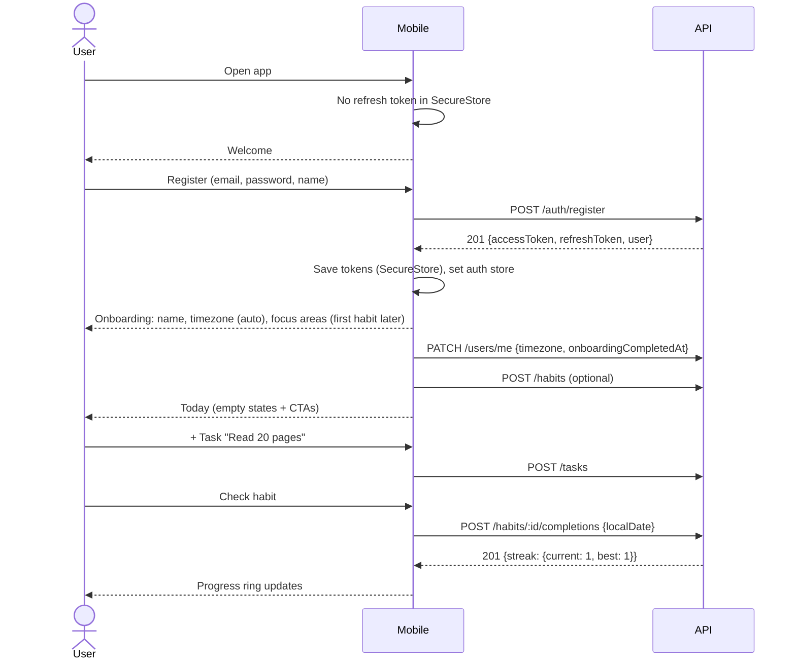
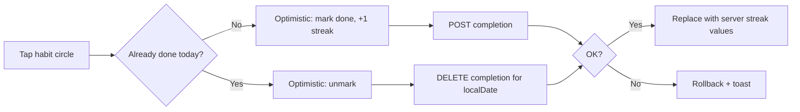

# 03 — User Flows & Navigation

| | |
|---|---|
| **Purpose** | How users move through the app: navigation tree, screen inventory, key flows |
| **Status** | Draft v0.1, awaiting review |
| **Last updated** | 2026-11-03 |
| **Related** | [02-Requirements](02-FUNCTIONAL-REQUIREMENTS.md) · [07-Design System](07-DESIGN-SYSTEM.md) |

---

## 1. Navigation architecture (Expo Router)

**Proposed:** 4 primary tabs + "More". Calendar is a tab because it is a daily-use view. Goals, Finance, Stats and Settings live under *More* until usage data says otherwise.

**Confirmed 2026-11-08 (the design export):** the tabs are **Today · Habits · Tasks · Money · Settings** (the design's Profile). Money shows "coming soon" until Finance (v1.1). **Calendar is not a tab:** it's pushed from the calendar button at the top of Habits (the design's Calendar screen has no tab bar).

```text
apps/mobile/src/app/
├── _layout.tsx                 # Root: providers (Theme, QueryClient, Auth gate)
├── index.tsx                   # Redirects based on auth + onboarding state
├── (auth)/
│   ├── _layout.tsx             # Stack, no tabs
│   ├── welcome.tsx
│   ├── login.tsx
│   ├── register.tsx
│   ├── forgot-password.tsx
│   └── reset-password.tsx      # deep link: lifeos://reset-password?token=
├── (onboarding)/
│   ├── _layout.tsx
│   ├── profile.tsx             # name + timezone
│   ├── focus-areas.tsx
│   ├── first-habit.tsx
│   └── focus.tsx
├── (app)/
│   ├── _layout.tsx             # Auth-protected
│   ├── (tabs)/
│   │   ├── _layout.tsx         # Bottom tab bar
│   │   ├── today.tsx
│   │   ├── tasks/index.tsx
│   │   ├── habits/index.tsx
│   │   ├── calendar.tsx
│   │   └── more.tsx
│   ├── tasks/[id].tsx          # Task detail/edit
│   ├── habits/[id].tsx         # Habit detail + history
│   ├── goals/index.tsx
│   ├── goals/[id].tsx
│   ├── events/[id].tsx
│   ├── settings/…              # profile, appearance, notifications, privacy, account
│   ├── finance/…               # v1.1
│   ├── stats/…                 # v2
│   └── assistant.tsx           # v2
└── (modals)/
    ├── task-form.tsx           # presentation: 'modal' / bottom sheet
    ├── habit-form.tsx
    ├── goal-form.tsx
    └── event-form.tsx
```

**Built in 5.7, changed 2026-11-08:** onboarding has two steps: `(onboarding)/profile` (name, pre-filled; time zone from the phone, editable, checked by the shared `timezoneSchema`) and `(onboarding)/focus` (pick 1–3 focus areas, FR-ONB-002; each becomes a task category). The theme step was removed: the theme is chosen in **Settings → Appearance**, as in the design. Finish creates the categories, then saves settings (time zone, follow-device flag, week start from the phone) and then `PATCH /users/me { displayName, onboardingCompleted: true }`; the gate opens Today. **Skip for now** still saves the phone's time zone and week start. **A first habit (FR-ONB-003) waits for habits.** The saved theme is re-applied after sign-in (`useThemeFromSettings`), so it follows the user to a new phone.

**Built in 5.5:** real Log in / Create account / Forgot password forms in `(auth)`. The email links live at the **root, outside the guards** (a change from the tree above, which had `reset-password` in `(auth)`): `reset-password`, `verify-email` and `confirm-email-change` must open whether or not the phone is signed in. Reset signs this phone out (the API ended every session).
**Open UI issue:** on iOS 26 the five-tab bar truncates "Habits" and "Calendar" ("Hab…", "Cal…") on an iPhone 17; revisit labels or tab count in the layout pass.

**Built in 5.2:** `(auth)` (welcome, login, register, forgot-password), `(onboarding)` (profile), `(app)` with native tabs (today, tasks, habits, calendar, more) plus `design-preview`. Tab screens are single files for now (`tasks.tsx`, not `tasks/index.tsx`) until they get detail screens. The root layout wraps each group in `Stack.Protected`, driven by one function, `areaFor(session)` in `src/features/auth/session.tsx`: signed out → `(auth)`, signed in but not onboarded → `(onboarding)`, onboarded → `(app)`. `index.tsx` redirects to that area's first screen (`/welcome`, `/profile`, `/today`). While the session is `loading` the splash screen stays up. Content is placeholders until 5.5 / 5.7 / Phase 6. A `__DEV__`-only "Demo: new / returning user" on welcome walks through the gate before real login exists.



**Auth gate rule:** the gate lives in `src/app/(app)/_layout.tsx`. It reads auth status from the Zustand auth store and redirects with `<Redirect href="/(auth)/welcome" />`. Screens never check auth themselves.

## 2. Screen inventory

| # | Screen | Route | Release | Key states |
|---|---|---|---|---|
| 1 | Splash | native splash + `index` | MVP | loading |
| 2 | Welcome | `(auth)/welcome` | MVP | — |
| 3 | Login | `(auth)/login` | MVP | idle, submitting, error, throttled |
| 4 | Register | `(auth)/register` | MVP | validation errors, email taken |
| 5 | Forgot / Reset password | `(auth)/…` | MVP | sent, invalid/expired token |
| 6 | Onboarding (4 steps) | `(onboarding)/…` | MVP | skip, back |
| 7 | Today | `(tabs)/today` | MVP | loading skeleton, empty day, all done 🎉, offline cached |
| 8 | Task list | `(tabs)/tasks` | MVP | empty, filtered-empty, loading more, error |
| 9 | Task detail / form | `tasks/[id]`, `(modals)/task-form` | MVP | create, edit, saving, delete confirm |
| 10 | Habit list | `(tabs)/habits` | MVP | empty, all checked |
| 11 | Habit detail | `habits/[id]` | MVP | history heatmap, stats |
| 12 | Habit form | `(modals)/habit-form` | MVP | frequency pickers |
| 13 | Calendar | `calendar` (pushed from Habits) | MVP | day / week / month segments |
| 14 | Event form | `(modals)/event-form` | MVP | recurrence picker |
| 15 | Goals list / detail / form | `goals/…` | MVP | progress, milestones |
| 16 | More | `(tabs)/more` | MVP | menu |
| 17 | Settings (5 sub-screens) | `settings/…` | MVP | export pending, delete confirm |
| 18 | Finance dashboard / transactions / budgets / savings | `finance/…` | v1.1 | |
| 19 | Achievements / level | `gamification/…` | v1.2 | |
| 20 | Stats / reports | `stats/…` | v2 | |
| 21 | Assistant | `assistant` | v2 | |

## 3. Key flows

### 3.1 First-run journey (MVP acceptance flow)



### 3.2 Quick-add task from Today
1. Tap **+** FAB → action sheet (Task / Habit / Event).
2. Task → bottom sheet with title field auto-focused. Due date defaults to *today*.
3. Optional chips: priority, category, time. Press **Enter** to save.
4. Optimistic insert into the Today list. On error: rollback + toast "Couldn't save, retry".

### 3.3 Habit check-in & undo


### 3.4 Recurring task completion
Complete occurrence → API marks it done **and** creates the next occurrence in the same DB transaction → response includes `nextOccurrence` → list cache updated.

### 3.5 Goal with linked tasks
Goal detail → "Link tasks" → multi-select sheet → `PUT /goals/:id/tasks` → progress recomputed server-side → progress bar animates.

### 3.6 Session expiry
API returns `401` → the API client attempts one refresh (single-flight lock) → on success, retries the original request → on failure, clears the session and redirects to Login with the message "Please sign in again".

### 3.7 Delete account
Settings → Account → Delete → explain consequences → re-enter password → `DELETE /users/me` → tokens revoked → logged out → confirmation screen. The account is purged by a scheduled job after 30 days.

## 4. Universal screen states

Every data screen must design and implement these four states (component patterns in [07](07-DESIGN-SYSTEM.md)):

| State | Pattern |
|---|---|
| Loading (first) | Skeletons that match the layout, never a full-screen spinner |
| Empty | Illustration/icon + one-line explanation + primary CTA |
| Error | Inline error card with Retry; offline banner when no connectivity |
| Success / populated | Normal content; pull-to-refresh |
