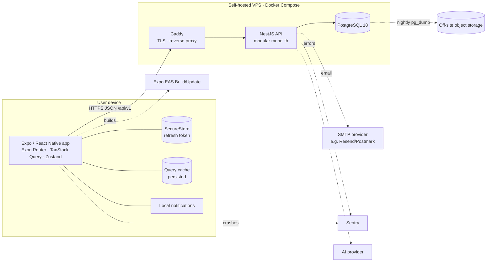
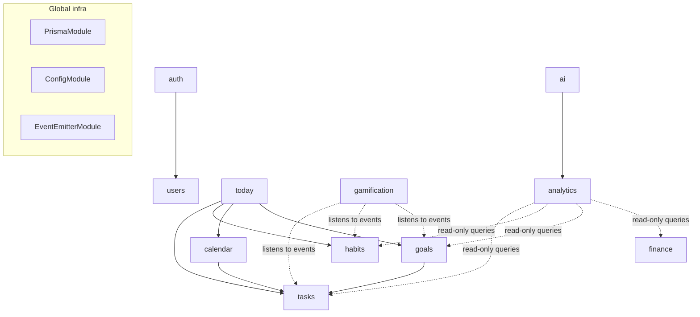

# 04 — System Architecture

| | |
|---|---|
| **Purpose** | How the system is structured, how parts communicate, and the cross-cutting rules (auth, errors, validation, security) |
| **Status** | Draft v0.1, awaiting review |
| **Last updated** | 2026-11-03 |
| **Related** | [05-Database](05-DATABASE-DESIGN.md) · [06-API](06-API-SPECIFICATION.md) · [11-Decisions](11-TECHNICAL-DECISIONS.md) · [10-Deployment](10-DEPLOYMENT-STRATEGY.md) |

---

## 1. System overview



**Architectural style:** one deployable NestJS backend (a *modular monolith*), one mobile app and one shared package. Modules are separated by folder, by Nest `Module` boundaries and by explicit public services. They are **not** separate services. Microservices are rejected for now (ADR-001): one developer, one database, low traffic, and transactions across tasks/habits/XP are much simpler in one process.

## 2. Monorepo structure (Confirmed: Bun workspaces)

```text
life-os/
├── apps/
│   ├── mobile/                    # Expo app (SDK 58 default template layout)
│   │   ├── src/
│   │   │   ├── app/               # Expo Router routes ONLY (thin screens)
│   │   │   ├── features/          # Feature slices: tasks/, habits/, goals/, calendar/, today/, auth/, settings/
│   │   │   │   └── tasks/
│   │   │   │       ├── api.ts         # fetch functions (uses services/http)
│   │   │   │       ├── queries.ts     # TanStack Query hooks + query keys
│   │   │   │       ├── components/    # TaskRow, TaskForm…
│   │   │   │       └── hooks/         # feature-specific hooks
│   │   │   ├── components/ui/     # Design-system primitives (Button, Card, Text…)
│   │   │   ├── theme/             # tokens, ThemeProvider, useTheme
│   │   │   ├── services/          # http client, secure storage, notifications
│   │   │   ├── store/             # Zustand stores (auth, ui prefs)
│   │   │   ├── hooks/             # cross-feature hooks (useNetwork, useAppState)
│   │   │   └── lib/               # date utils, formatters
│   │   ├── assets/
│   │   └── app.config.ts
│   │
│   └── api/                       # NestJS 12 app (ESM, Vitest, oxlint)
│       ├── src/
│       │   ├── main.ts
│       │   ├── app.module.ts
│       │   ├── config/            # typed env config (validated with Zod at boot)
│       │   ├── prisma/            # PrismaService (global module)
│       │   ├── common/            # filters, guards, interceptors, decorators, pipes
│       │   └── modules/
│       │       ├── auth/
│       │       ├── users/
│       │       ├── tasks/
│       │       ├── habits/
│       │       ├── goals/
│       │       ├── calendar/      # (brief called it "schedules")
│       │       ├── today/         # read-only aggregation
│       │       ├── notifications/ # email now, push later
│       │       ├── finance/       # v1.1
│       │       ├── gamification/  # v1.2
│       │       ├── analytics/     # v2
│       │       └── ai/            # v2
│       ├── prisma/
│       │   ├── schema.prisma
│       │   ├── migrations/
│       │   └── seed.ts
│       └── test/                  # e2e / integration tests
│
├── packages/
│   └── shared/                    # Zod schemas, inferred TS types, enums, date helpers
│       └── src/{tasks,habits,…}.ts
│
├── docs/
├── docker-compose.yml             # local: postgres (+ api optional)
├── docker-compose.prod.yml        # VPS: caddy, api, postgres, backup
├── .github/workflows/
├── bunfig.toml / package.json     # workspaces: ["apps/*", "packages/*"]
└── README.md
```

**Changes from the brief's proposal and why:**
- `src/app/` holds routes only (Expo's default location since SDK 55+), and logic lives in `src/features`. Screens stay thin and features stay testable without the router.
- Added `today/` (aggregation) and `notifications/` modules. Renamed `schedules` → `calendar` to match the product language.
- Added `config/` and `prisma/` at the API root because they are infrastructure, not features.
- `packages/shared` holds **Zod schemas** used by the mobile forms *and* the API validation pipe. One definition means the mobile and API validation can't drift apart.

### Shared package boundaries
- ✅ Zod schemas, enums (`Priority`, `HabitFrequency`), pure date helpers (`toLocalDate(tz)`), API response types.
- ❌ No React, no NestJS, no Prisma imports. It must stay runtime-agnostic.
- ⚠️ **No build step:** the API runs `shared`'s `.ts` source directly via Node's built-in type stripping, and Metro compiles it for mobile. So `shared` may only use *erasable* TypeScript: no `enum`, `namespace` or constructor parameter properties (use `as const` arrays + union types instead), and relative imports include the `.ts` extension. `erasableSyntaxOnly` in `packages/shared/tsconfig.json` enforces this.

## 3. Backend architecture (NestJS)

### 3.1 Module anatomy
```text
modules/tasks/
├── tasks.module.ts         # wires providers, declares exports
├── tasks.controller.ts     # HTTP only: routing, DTO binding, status codes
├── tasks.service.ts        # business rules, transactions
├── tasks.repository.ts     # (optional) Prisma queries when service grows
├── dto/                    # createZodDto(...) from @life-os/shared schemas
├── recurrence.ts           # pure functions: nextOccurrence(task) — easy to unit test
└── __tests__/
```

**Request flow (create task):**
`POST /api/v1/tasks` → `JwtAuthGuard` (sets `req.user`) → `ZodValidationPipe` (body → DTO) → `TasksController.create(@CurrentUser() user, dto)` → `TasksService.create(user.id, dto)` → `prisma.task.create({ data: { ...dto, userId } })` → `TransformInterceptor` wraps `{ data }` → `201`.

### 3.2 Dependency rules between modules



Rules:
1. A module may call another module **only through its exported service**, never through its controller and never by reaching into its Prisma models directly.
2. **No cycles.** If two modules need each other, use a **domain event**. Example: `HabitsService` emits `habit.completed` and `GamificationListener` awards XP. Habits doesn't know gamification exists.
3. `today` and `analytics` are **read-only** aggregators.
4. Domain events start in-process (`@nestjs/event-emitter`). Listeners whose side effects must not be lost (XP) are written in the same DB transaction via an **outbox table** *(Proposed for v1.2)*.

### 3.3 Dependency injection
NestJS creates and injects services. `TasksService` receives `PrismaService` in its constructor. Tests replace it with a mock or a test database, which is the main practical benefit of DI for this project.

## 4. Mobile architecture

### 4.1 State: who owns what

| Kind of state | Tool | Examples |
|---|---|---|
| Server state (data from the API) | **TanStack Query** | tasks, habits, today, goals |
| Client session state | **Zustand** | `authStatus`, current user id, access token (memory only) |
| UI preferences | **Zustand + persist (MMKV/AsyncStorage)** | theme override, last calendar view |
| Form state | **React Hook Form + Zod resolver** | task form |
| Secrets | **expo-secure-store** | refresh token |

**Rule:** never copy server data into Zustand. If a component needs tasks, it calls `useTasks()`.

### 4.2 Query keys & invalidation (example)
```ts
export const taskKeys = {
  all: ['tasks'] as const,
  list: (f: TaskFilters) => [...taskKeys.all, 'list', f] as const,
  detail: (id: string) => [...taskKeys.all, 'detail', id] as const,
};
// After completing a task: invalidate taskKeys.all and ['today'].
```

### 4.3 HTTP client
- A thin `fetch` wrapper (`services/http.ts`). **No axios** unless needed; one less dependency.
- Injects `Authorization: Bearer <access>`.
- On `401`: single-flight refresh → retry once → otherwise logout.
- Parses the standard error envelope into an `ApiError` class (`code`, `message`, `fieldErrors`).
- Base URL from `app.config.ts` `extra.apiUrl` per EAS profile.

### 4.4 Offline/connectivity (MVP level)
- Persist the TanStack Query cache so Today/Tasks render offline with "last updated" info.
- `onlineManager` wired to NetInfo. Mutations while offline are *paused* and replayed when back online. Habit check-ins are idempotent per `localDate`, so replay is safe.
- No full offline-first sync (deferred).

## 5. Authentication & authorization

| Aspect | Decision (Proposed, ADR-004) |
|---|---|
| Password hashing | `argon2id` |
| Access token | JWT, 15 min, signed HS256 (single service), claims: `sub`, `sid` |
| Refresh token | Opaque random 256-bit, **stored hashed** in `Session` table, 30-day TTL, rotated on every refresh |
| Reuse detection | Using an already-rotated refresh token revokes the whole session family |
| Storage on device | Refresh token in SecureStore; access token in memory only |
| Authorization | All resources are user-owned. Every service method takes `userId` from the token and includes it in `where`. Accessing another user's id returns `404`, not `403`, so ids can't be probed |
| Email flows | Verification + reset tokens are random, hashed in DB, single-use, 1 h expiry |
| Roles | `USER` only in MVP. `ADMIN` reserved for future moderation/support |

**Why not Passport sessions / cookies?** The client is a mobile app, so bearer tokens are the natural fit. Cookies add CSRF concerns and don't add value here.

## 6. Error handling strategy

**API:** one global `AllExceptionsFilter` maps everything to:
```json
{
  "error": {
    "code": "VALIDATION_FAILED",
    "message": "Some fields are invalid.",
    "details": [{ "field": "title", "message": "Required" }],
    "requestId": "01HF…"
  }
}
```
- Domain errors are thrown as typed exceptions (`TaskNotFoundError extends NotFoundException`) with stable `code`s.
- Prisma `P2002` (unique) → `409 CONFLICT`. `P2025` (not found) → `404`.
- Unknown errors → `500 INTERNAL_ERROR` with a generic message. The stack trace goes to logs and Sentry only.
- Every request gets a `requestId` (header `X-Request-Id`) included in logs and responses.

**Mobile:**
- Query errors → screen-level `<ErrorState onRetry>`.
- Mutation errors → toast + rollback of optimistic updates.
- Form errors → `details[]` mapped onto fields with `setError`.
- React `ErrorBoundary` at the root → "Something went wrong" + reload. The error is reported to Sentry.

## 7. Validation
- **Single source:** Zod schemas in `packages/shared`.
- API: `nestjs-zod` (or a ~20-line custom `ZodValidationPipe`) validates body/query/params. *Proposed:* custom pipe, so there is less magic and it's easier to learn from.
- Mobile: `zodResolver(createTaskSchema)` in React Hook Form.
- The DB enforces what must never break: NOT NULL, FKs, unique and check constraints.

## 8. Security considerations

| Threat | Control |
|---|---|
| IDOR (reading others' data) | `userId` scoping in every query; e2e tests attempt cross-user access |
| Brute force | `@nestjs/throttler` on auth; argon2 cost; generic error messages |
| Token theft | Short access TTL, rotating refresh, SecureStore, logout-all |
| Injection | Prisma parameterized queries; raw SQL only via `Prisma.sql` tagged templates |
| Mass assignment | Zod schemas whitelist fields (`.strict()`); `userId` never accepted from the body |
| XP/streak manipulation | Computed server-side; client values ignored |
| Secrets leakage | `.env` git-ignored; GitHub Actions secrets; no secrets in the mobile bundle (anything in `app.config` is public) |
| Transport | TLS via Caddy, HSTS; API not exposed except through Caddy |
| Server hardening | SSH keys only, UFW (80/443/22), unattended-upgrades, Postgres not publicly exposed |
| AI (v2) | Prompt-injection-safe design: AI only *proposes*, and the user confirms; data minimization |
| Dependencies | Dependabot/Renovate; `bun audit` equivalent in CI (Proposed: `osv-scanner`) |

## 9. Cross-cutting concerns
- **Config:** `config/env.ts` parses `process.env` with Zod at boot, so the app fails fast with a clear message if a variable is missing.
- **Logging:** `pino` (via `nestjs-pino`), JSON in production, pretty in development. PII redaction for `email`, `password` and `authorization`.
- **Time:** `date-fns` + `date-fns-tz` (Proposed) on both sides. The server is always UTC.
- **API docs:** Swagger at `/api/docs` (disabled or protected in production).
- **Health:** `GET /health` (DB ping) for uptime checks and the Docker healthcheck.
