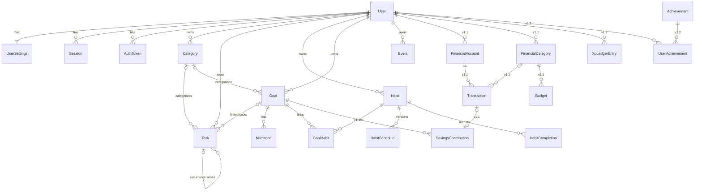

# 05 — Database Design

| | |
|---|---|
| **Purpose** | Entities, relationships, Prisma schema proposal, indexes, migration and integrity strategy |
| **Status** | Draft v0.1 (Proposed, not yet migrated) |
| **Last updated** | 2026-11-03 |
| **Related** | [02-Requirements](02-FUNCTIONAL-REQUIREMENTS.md) · [06-API](06-API-SPECIFICATION.md) · [11-Decisions](11-TECHNICAL-DECISIONS.md) |

---

## 1. Evaluation of the proposed entity list

The brief proposed 19 entities. The table shows the decision for each:

| Proposed entity | Decision | Release | Reason |
|---|---|---|---|
| User | ✅ keep | MVP | Root owner of all data |
| UserPreference | ✅ keep as 1:1 `UserSettings` | MVP | Keeps `User` lean (auth fields) and separates preferences |
| — | ➕ add `Session` | MVP | Refresh-token rotation and logout-all need it |
| — | ➕ add `AuthToken` | MVP | Email verification and password reset tokens |
| Task | ✅ keep | MVP | |
| TaskCategory | ✅ keep as `Category` | MVP | Reused by tasks, goals and habits (one table, `scope` not needed). Finance gets its own table because its semantics differ |
| Subtask | ⚠️ merge into Task via `parentId` | MVP | Same fields as Task. A self-relation avoids a duplicate table. Depth limited to 1 in service logic |
| — | ➕ add `TaskRecurrence` (embedded fields on Task) | MVP | `recurrenceRule` + `recurrenceParentId` on Task; no separate table needed |
| Habit | ✅ keep | MVP | |
| — | ➕ add `HabitSchedule` | MVP | Versions frequency rules so streak history survives frequency changes (FR-HAB rule 7) |
| HabitCompletion | ✅ keep | MVP | One row per habit per local date |
| Goal | ✅ keep | MVP | |
| GoalMilestone | ✅ keep as `Milestone` | MVP | |
| CalendarEvent | ✅ keep as `Event` | MVP | |
| Reminder | ⚠️ defer table | MVP uses fields | MVP reminders are local notifications configured via fields (`Habit.reminderTimes`, `Event.reminderMinutes`). A generic Reminder table only becomes necessary with server push (v1.2+) |
| Notification | ⏸ defer | v1.2 | Needed only for an in-app inbox / server push |
| Transaction | ✅ keep | v1.1 | |
| FinancialCategory | ✅ keep | v1.1 | Income vs expense type, budgets attach here |
| — | ➕ add `FinancialAccount` | v1.1 | Cash vs bank vs mobile money; transfers need two accounts |
| Budget | ✅ keep | v1.1 | Per category per month |
| SavingsGoal | ⚠️ merge with `Goal` + `SavingsContribution` | v1.1 | A savings goal *is* a goal with `targetAmountMinor`. Avoids two parallel goal systems |
| Achievement | ✅ keep (catalog) | v1.2 | Seeded definitions |
| UserAchievement | ✅ keep | v1.2 | |
| XPTransaction | ✅ keep as `XpLedgerEntry` | v1.2 | Append-only ledger |
| — | ➕ `Challenge`, `UserChallenge` | v1.2 | Weekly challenges |
| — | ➕ `OutboxEvent` | v1.2 | Reliable domain events for gamification |

**MVP table count: 13**: User, UserSettings, Session, AuthToken, Category, Task, Habit, HabitSchedule, HabitCompletion, Goal, Milestone, GoalHabit (join), Event.

## 2. ERD (MVP + v1.1 + v1.2)



## 3. Key modelling decisions (plain-language)

1. **IDs:** `String @id @default(uuid(7))` *(Proposed: UUIDv7, which is time-sortable, so indexes stay efficient and cursor pagination is simple)*. UUIDs (not auto-increment) keep ids from being guessable in URLs.
2. **Time:** every timestamp is `@db.Timestamptz(3)` in UTC. Day-based things (habit completion, task due *date*) also store a `@db.Date` **local date** computed in the user's time zone at write time. This avoids the classic bug where "today" in Dar es Salaam (UTC+3) is still "yesterday" in UTC at 01:00.
3. **Due dates on tasks:** `dueDate` (DATE, required for scheduled tasks) + optional `dueTime` (minutes since midnight, local). "Due Friday" and "Due Friday 17:00" are both modelled without TZ ambiguity.
4. **Money (v1.1):** `BigInt amountMinor` + `String currency` (ISO 4217). TZS has 0 decimal digits in practice and USD has 2. Integer minor units avoid float errors (`0.1 + 0.2 ≠ 0.3`), and BigInt avoids overflow. Formatting happens in the UI. *(ADR-005)*
5. **Soft delete:** `deletedAt` on user-generated content (Task, Habit, Goal, Event, Transaction) to allow undo and a 30-day trash. **Not** on completions or ledger entries: completions are hard-deleted on undo, and the ledger is append-only. Every read filters `deletedAt: null` (centralised in the repository layer or a Prisma client extension).
6. **Ownership:** every user-owned table has `userId` + an FK with `onDelete: Cascade`, so account purge is one `DELETE FROM "User"`.
7. **Enums:** Postgres enums via Prisma for closed sets (priority, status). Free-form values (icons, colors) are strings validated by Zod.

## 4. Prisma schema proposal (MVP, with v1.1/v1.2 sketched)

```prisma
generator client {
  provider = "prisma-client-js"
}

datasource db {
  provider = "postgresql"
  url      = env("DATABASE_URL")
}

// ───────────── Identity ─────────────

model User {
  id                    String    @id @default(uuid(7)) @db.Uuid
  email                 String    @unique // stored lowercased (service-enforced)
  passwordHash          String
  displayName           String    @db.VarChar(80)
  emailVerifiedAt       DateTime? @db.Timestamptz(3)
  onboardingCompletedAt DateTime? @db.Timestamptz(3)
  role                  Role      @default(USER)
  createdAt             DateTime  @default(now()) @db.Timestamptz(3)
  updatedAt             DateTime  @updatedAt @db.Timestamptz(3)
  deletedAt             DateTime? @db.Timestamptz(3) // scheduled for purge

  settings   UserSettings?
  sessions   Session[]
  authTokens AuthToken[]
  categories Category[]
  tasks      Task[]
  habits     Habit[]
  goals      Goal[]
  events     Event[]
}

enum Role {
  USER
  ADMIN
}

model UserSettings {
  userId               String   @id @db.Uuid
  timezone             String   @default("UTC") // IANA, e.g. "Africa/Dar_es_Salaam"
  followDeviceTimezone Boolean  @default(true)
  weekStartsOn         Int      @default(1) @db.SmallInt // 0=Sun … 6=Sat
  theme                Theme    @default(SYSTEM)
  currency             String   @default("TZS") @db.Char(3) // v1.1
  habitRemindersOn     Boolean  @default(true)
  eventReminderDefault Int?     @db.SmallInt // minutes before
  crashReportsOn       Boolean  @default(true)
  aiEnabled            Boolean  @default(false) // v2
  updatedAt            DateTime @updatedAt @db.Timestamptz(3)

  user User @relation(fields: [userId], references: [id], onDelete: Cascade)
}

enum Theme {
  SYSTEM
  DARK
  LIGHT
}

model Session {
  id               String    @id @default(uuid(7)) @db.Uuid
  userId           String    @db.Uuid
  familyId         String    @db.Uuid // all rotations of one login share this
  refreshTokenHash String    @unique
  deviceName       String?   @db.VarChar(100)
  expiresAt        DateTime  @db.Timestamptz(3)
  rotatedAt        DateTime? @db.Timestamptz(3) // set when replaced → reuse = attack
  revokedAt        DateTime? @db.Timestamptz(3)
  createdAt        DateTime  @default(now()) @db.Timestamptz(3)

  user User @relation(fields: [userId], references: [id], onDelete: Cascade)

  @@index([userId])
  @@index([familyId])
}

model AuthToken {
  id        String        @id @default(uuid(7)) @db.Uuid
  userId    String        @db.Uuid
  type      AuthTokenType
  tokenHash String        @unique
  expiresAt DateTime      @db.Timestamptz(3)
  usedAt    DateTime?     @db.Timestamptz(3)
  newEmail  String? // EMAIL_CHANGE only (4.9)
  createdAt DateTime      @default(now()) @db.Timestamptz(3)

  user User @relation(fields: [userId], references: [id], onDelete: Cascade)

  @@index([userId, type])
}

enum AuthTokenType {
  EMAIL_VERIFICATION
  PASSWORD_RESET
  EMAIL_CHANGE // 4.9
}

// ───────────── Organisation ─────────────

// Built in 6.1 (migration add_categories_and_tasks): Category as below but `color` is a palette
// name (VarChar(20)); Task with the Tasks I columns only. goalId / parentId / recurrence* /
// isPinnedForDate are added by their modules (Goals, Tasks II, Today) as additive migrations.
model Category {
  id        String   @id @default(uuid(7)) @db.Uuid
  userId    String   @db.Uuid
  name      String   @db.VarChar(50)
  color     String   @db.VarChar(9) // token name or hex
  icon      String?  @db.VarChar(40)
  sortOrder Int      @default(0)
  createdAt DateTime @default(now()) @db.Timestamptz(3)
  updatedAt DateTime @updatedAt @db.Timestamptz(3)

  user  User   @relation(fields: [userId], references: [id], onDelete: Cascade)
  tasks Task[]
  goals Goal[]

  @@unique([userId, name]) // name is citext since 2026-11-08: "Gym" and "GYM" are the same name
}

// ───────────── Tasks ─────────────

model Task {
  id          String       @id @default(uuid(7)) @db.Uuid
  userId      String       @db.Uuid
  title       String       @db.VarChar(200)
  description String?      @db.VarChar(5000)
  priority    TaskPriority @default(NONE)
  status      TaskStatus   @default(TODO)
  dueDate     DateTime?    @db.Date // user-local calendar date
  dueTime     Int?         @db.SmallInt // minutes from local midnight (0–1439)
  isPinnedForDate DateTime? @db.Date // "Top priority" for that local date
  completedAt DateTime?    @db.Timestamptz(3)
  sortOrder   Int          @default(0)

  categoryId String? @db.Uuid
  goalId     String? @db.Uuid
  parentId   String? @db.Uuid // subtask → parent (depth 1, service-enforced)

  // Recurrence: the template is the first task; each occurrence points to it.
  recurrenceRule     String? @db.VarChar(200) // RRULE subset, e.g. "FREQ=WEEKLY;BYDAY=MO,WE"
  recurrenceSeriesId String? @db.Uuid

  createdAt DateTime  @default(now()) @db.Timestamptz(3)
  updatedAt DateTime  @updatedAt @db.Timestamptz(3)
  deletedAt DateTime? @db.Timestamptz(3)

  user     User      @relation(fields: [userId], references: [id], onDelete: Cascade)
  category Category? @relation(fields: [categoryId], references: [id], onDelete: SetNull)
  goal     Goal?     @relation(fields: [goalId], references: [id], onDelete: SetNull)
  parent   Task?     @relation("Subtasks", fields: [parentId], references: [id], onDelete: Cascade)
  subtasks Task[]    @relation("Subtasks")

  @@index([userId, status, dueDate])  // Today + list filters
  @@index([userId, completedAt])      // history, stats
  @@index([userId, categoryId])
  @@index([goalId])
  @@index([parentId])
  @@index([recurrenceSeriesId])
}

enum TaskPriority {
  NONE
  LOW
  MEDIUM
  HIGH
  URGENT
}

enum TaskStatus {
  TODO
  DONE
}

// ───────────── Habits ─────────────

model Habit {
  id            String    @id @default(uuid(7)) @db.Uuid
  userId        String    @db.Uuid
  name          String    @db.VarChar(80)
  icon          String?   @db.VarChar(40)
  color         String    @db.VarChar(9)
  targetCount   Int       @default(1) @db.SmallInt // e.g. 8 glasses
  unit          String?   @db.VarChar(20)
  reminderTimes Int[]     @db.SmallInt // minutes from local midnight
  startDate     DateTime  @db.Date
  archivedAt    DateTime? @db.Timestamptz(3)
  sortOrder     Int       @default(0)

  // Denormalised, recomputed server-side on each completion change
  currentStreak Int @default(0)
  bestStreak    Int @default(0)

  createdAt DateTime  @default(now()) @db.Timestamptz(3)
  updatedAt DateTime  @updatedAt @db.Timestamptz(3)
  deletedAt DateTime? @db.Timestamptz(3)

  user        User              @relation(fields: [userId], references: [id], onDelete: Cascade)
  schedules   HabitSchedule[]
  completions HabitCompletion[]
  goals       GoalHabit[]

  @@index([userId, archivedAt])
}

/// A frequency rule valid from `effectiveFrom` until the next schedule's start.
model HabitSchedule {
  id            String         @id @default(uuid(7)) @db.Uuid
  habitId       String         @db.Uuid
  frequency     HabitFrequency
  weekdays      Int[]          @db.SmallInt // for WEEKLY_DAYS: 0–6
  timesPerWeek  Int?           @db.SmallInt // for TIMES_PER_WEEK
  effectiveFrom DateTime       @db.Date
  createdAt     DateTime       @default(now()) @db.Timestamptz(3)

  habit Habit @relation(fields: [habitId], references: [id], onDelete: Cascade)

  @@unique([habitId, effectiveFrom])
}

enum HabitFrequency {
  DAILY
  WEEKLY_DAYS
  TIMES_PER_WEEK
}

model HabitCompletion {
  id          String   @id @default(uuid(7)) @db.Uuid
  habitId     String   @db.Uuid
  userId      String   @db.Uuid // denormalised for fast per-user queries & scoping
  localDate   DateTime @db.Date
  count       Int      @default(1) @db.SmallInt
  completedAt DateTime @default(now()) @db.Timestamptz(3)

  habit Habit @relation(fields: [habitId], references: [id], onDelete: Cascade)

  @@unique([habitId, localDate]) // idempotent check-ins
  @@index([userId, localDate])   // Today + stats
}

// ───────────── Goals ─────────────

model Goal {
  id           String       @id @default(uuid(7)) @db.Uuid
  userId       String       @db.Uuid
  title        String       @db.VarChar(120)
  description  String?      @db.VarChar(5000)
  status       GoalStatus   @default(ACTIVE)
  progressMode ProgressMode @default(MILESTONES)
  manualProgress Int?       @db.SmallInt // 0–100 when MANUAL
  targetDate   DateTime?    @db.Date
  completedAt  DateTime?    @db.Timestamptz(3)
  categoryId   String?      @db.Uuid

  // v1.1 savings goals
  targetAmountMinor BigInt?
  currency          String? @db.Char(3)

  createdAt DateTime  @default(now()) @db.Timestamptz(3)
  updatedAt DateTime  @updatedAt @db.Timestamptz(3)
  deletedAt DateTime? @db.Timestamptz(3)

  user       User        @relation(fields: [userId], references: [id], onDelete: Cascade)
  category   Category?   @relation(fields: [categoryId], references: [id], onDelete: SetNull)
  milestones Milestone[]
  tasks      Task[]
  habits     GoalHabit[]

  @@index([userId, status, targetDate])
}

enum GoalStatus {
  ACTIVE
  COMPLETED
  ABANDONED
}

enum ProgressMode {
  MILESTONES
  TASKS
  MANUAL
  SAVINGS // v1.1
}

model Milestone {
  id          String    @id @default(uuid(7)) @db.Uuid
  goalId      String    @db.Uuid
  title       String    @db.VarChar(120)
  dueDate     DateTime? @db.Date
  completedAt DateTime? @db.Timestamptz(3)
  sortOrder   Int       @default(0)
  createdAt   DateTime  @default(now()) @db.Timestamptz(3)
  updatedAt   DateTime  @updatedAt @db.Timestamptz(3)

  goal Goal @relation(fields: [goalId], references: [id], onDelete: Cascade)

  @@index([goalId, sortOrder])
}

model GoalHabit {
  goalId  String @db.Uuid
  habitId String @db.Uuid

  goal  Goal  @relation(fields: [goalId], references: [id], onDelete: Cascade)
  habit Habit @relation(fields: [habitId], references: [id], onDelete: Cascade)

  @@id([goalId, habitId])
  @@index([habitId])
}

// ───────────── Calendar ─────────────

model Event {
  id              String    @id @default(uuid(7)) @db.Uuid
  userId          String    @db.Uuid
  title           String    @db.VarChar(120)
  notes           String?   @db.VarChar(5000)
  location        String?   @db.VarChar(200)
  color           String?   @db.VarChar(9)
  allDay          Boolean   @default(false)
  startsAt        DateTime  @db.Timestamptz(3)
  endsAt          DateTime  @db.Timestamptz(3)
  timezone        String    // IANA zone the event was created in (for recurrence expansion)
  recurrenceRule  String?   @db.VarChar(200)
  recurrenceUntil DateTime? @db.Timestamptz(3)
  reminderMinutes Int?      @db.SmallInt

  createdAt DateTime  @default(now()) @db.Timestamptz(3)
  updatedAt DateTime  @updatedAt @db.Timestamptz(3)
  deletedAt DateTime? @db.Timestamptz(3)

  user User @relation(fields: [userId], references: [id], onDelete: Cascade)

  @@index([userId, startsAt])
}

// ───────────── v1.1 Finance (sketch) ─────────────
// model FinancialAccount { id, userId, name, type(CASH|BANK|MOBILE_MONEY), currency Char(3), openingBalanceMinor BigInt, archivedAt }
// model FinancialCategory { id, userId, name, kind(INCOME|EXPENSE), color, icon  @@unique([userId, name, kind]) }
// model Transaction {
//   id, userId, accountId, categoryId?, type(INCOME|EXPENSE|TRANSFER),
//   amountMinor BigInt  // always positive; sign comes from type
//   currency Char(3), occurredOn Date, note?, transferPairId? Uuid, deletedAt?
//   @@index([userId, occurredOn]) @@index([userId, categoryId, occurredOn])
// }
// model Budget { id, userId, categoryId, month Date (1st of month), limitMinor BigInt  @@unique([userId, categoryId, month]) }
// model SavingsContribution { id, goalId, transactionId? @unique, amountMinor BigInt, occurredOn Date }

// ───────────── v1.2 Gamification (sketch) ─────────────
// model XpLedgerEntry { id, userId, amount Int, reason(enum), sourceType, sourceId, createdAt
//   @@unique([userId, reason, sourceType, sourceId])  // no double-award
//   @@index([userId, createdAt]) }
// model Achievement { id, key @unique, title, description, icon, xpReward, criteria Json }
// model UserAchievement { userId, achievementId, unlockedAt  @@id([userId, achievementId]) }
// model Challenge / UserChallenge / OutboxEvent
```

**CHECK constraints** that Prisma can't express are added in raw SQL inside the migration:
```sql
ALTER TABLE "Task"  ADD CONSTRAINT task_due_time_range  CHECK ("dueTime" IS NULL OR "dueTime" BETWEEN 0 AND 1439);
ALTER TABLE "Task"  ADD CONSTRAINT task_no_self_parent  CHECK ("parentId" IS NULL OR "parentId" <> "id");
ALTER TABLE "Event" ADD CONSTRAINT event_end_after_start CHECK ("endsAt" >= "startsAt");
ALTER TABLE "Goal"  ADD CONSTRAINT goal_manual_progress CHECK ("manualProgress" IS NULL OR "manualProgress" BETWEEN 0 AND 100);
-- v1.1: ALTER TABLE "Transaction" ADD CONSTRAINT tx_amount_positive CHECK ("amountMinor" > 0);
```

## 5. Important relationships explained

- **Task ↔ Task (subtasks):** a subtask is just a Task with `parentId`. Deleting a parent cascades to its subtasks. The service rejects a `parentId` that itself has a parent (depth 1). **Built 2026-11-08** (migration `add_subtasks`: nullable `parentId`, `@@index([parentId])`, FK `ON DELETE CASCADE`).
- **Task recurrence:** *(built 2026-11-08, migration `add_task_recurrence`; one change from the plan: the first task leaves `recurrenceSeriesId` null and the series id is `recurrenceSeriesId ?? id`, which saves a second write on create)* every occurrence holds `recurrenceRule`; later ones point to the first with `recurrenceSeriesId`. When an occurrence is completed, the service computes the next `dueDate` (pure function, unit-tested) and inserts the next row **in the same transaction**. Generating one occurrence at a time keeps the table small.
- **Habit ↔ HabitSchedule:** streak calculation loads the schedules ordered by `effectiveFrom` and picks the rule in force on each date. *(Built 2026-11-08, migration `add_habits`: `Habit`, `HabitSchedule`, `HabitCompletion`. `reminderTimes` added 2026-11-09 (migration `add_habit_reminder_times`, up to 3, sorted). The cached `currentStreak` / `bestStreak` are left until they're needed. `color` is a palette name like categories, not hex.)*
- **Habit streak denormalisation:** `currentStreak`/`bestStreak` are cached on `Habit` so Today doesn't recompute history. They're recomputed in the same transaction as each completion insert/delete, and a nightly job reconciles them (the job also lets a streak "break" overnight without user action).
- **Goals:** *built 2026-11-09, migration `add_goals`: `Goal`, `Milestone`, `GoalHabit`, nullable `Task.goalId` (ON DELETE SET NULL) and the `goal_manual_progress` CHECK. The v1.1 savings columns and the `SAVINGS` mode are left for Finance. Deleting a goal (soft) unlinks its tasks in the same transaction.*
- **Goal progress:** computed on read (cheap): `MILESTONES` = done/total milestones, `TASKS` = done/total linked tasks, `MANUAL` = `manualProgress`, `SAVINGS` = sum(contributions)/target.
- **Calendar:** Events are stored. Tasks/habits are *projected* into calendar responses and not duplicated.

## 6. Indexing strategy

Principles: index by **access pattern**, always lead with `userId` (every query is user-scoped), and add indexes only for real queries.

| Query | Index |
|---|---|
| Today: tasks due ≤ today, not done | `Task(userId, status, dueDate)` |
| Task history / completion stats | `Task(userId, completedAt)` |
| Today: completions for date | `HabitCompletion(userId, localDate)` |
| Habit history | `HabitCompletion(habitId, localDate)` (from the unique constraint) |
| Calendar range | `Event(userId, startsAt)` |
| Goals list | `Goal(userId, status, targetDate)` |
| Token lookup | unique on `refreshTokenHash`, `tokenHash` |
| Search tasks (MVP) | `ILIKE` on title, acceptable at personal scale. **Later:** `pg_trgm` GIN index or a `tsvector` column |

**Partial indexes (Proposed, raw SQL):** `CREATE INDEX ... ON "Task"("userId","dueDate") WHERE "deletedAt" IS NULL AND status='TODO';` This keeps the hot Today query small. Verify the benefit with `EXPLAIN ANALYZE` before adding it.

## 7. Migration strategy

1. **Tooling:** `bun run db:migrate` (`prisma migrate dev`) locally creates SQL files, which are committed. Then `bun run --filter @life-os/api prisma:generate` refreshes the client (Prisma 7 no longer does this automatically). `prisma migrate deploy` in CI/prod. **Never** `db push` against shared/prod databases. UUIDv7 ids are generated by Prisma (`@default(uuid(7))`), not by a DB default.
2. **One migration per PR/feature**, named meaningfully (`20261201_add_habit_schedule`).
3. **Review the generated SQL** before committing, since that's where data-loss risks show up.
4. **Expand → migrate → contract** for breaking changes: add the new column (nullable) → backfill → switch code → drop the old column in a later release. This matters because old mobile app versions stay in the wild for weeks.
5. **Seeds:** `prisma/seed.ts` for dev fixtures + production-safe catalog data (achievements in v1.2).
6. **Production:** the migration runs as a one-off container *before* the new API container starts, and a backup is taken right before (see [10](10-DEPLOYMENT-STRATEGY.md)).
7. **Rollback:** forward-only. Fix-forward with a new migration. Restore from backup only for disasters.

## 8. Data integrity considerations

- **Transactions** (`prisma.$transaction`) for: completing a recurring task + creating the next occurrence, habit completion + streak update, (v1.1) transfers creating two linked transactions, (v1.2) action + XP ledger entry.
- **Idempotency:** unique `(habitId, localDate)` and the XP ledger's unique `(userId, reason, sourceType, sourceId)` make retries safe.
- **Ownership checks for related ids:** when a client sends `categoryId` or `goalId`, the service verifies it belongs to the same user before writing. FKs alone don't guarantee this.
- **Money:** integers only, aggregated in SQL (`SUM("amountMinor")`) and returned as strings in JSON (BigInt isn't JSON-safe).
- **Purge job:** daily job hard-deletes soft-deleted rows older than 30 days and users with `deletedAt` older than 30 days.
- **Auth tokens (4.6):** one-time email links; only SHA-256 stored, `usedAt` set by compare-and-set, older unused tokens of the same type deleted when a new one is issued. The purge job also deletes expired or used rows.
- **Sessions:** every refresh adds a row (about one per 15 minutes of app use), and rotated rows must be kept until their family expires so reuse can still be detected. The purge job also deletes `Session` rows whose `expiresAt` is in the past. (Built in 4.5: the table; the job comes with the other scheduled jobs.)
- **Backups:** nightly `pg_dump` and a monthly restore test (NFR-REL-001).
