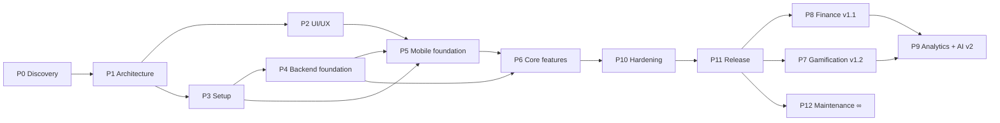

# 08 — Development Roadmap

| | |
|---|---|
| **Purpose** | Dependency-aware, week-by-week plan with milestones, tasks and done criteria |
| **Status** | v1.0, approved 2026-11-04 |
| **Last updated** | 2026-11-03 |
| **Related** | [01-PRD](01-PRD.md) · [12-Learning Log](12-LEARNING-LOG.md) · [09-Testing](09-TESTING-STRATEGY.md) |

---

## 1. Timeline realism

The brief targets 16–20 weeks for *everything*: 10 modules, a public release on two stores, self-hosted infrastructure, and learning most of the stack. With **10–15 h/week** (PRD A1, Confirmed 2026-11-04) that isn't realistic without cutting quality.

**How to read the week numbers:** each "Week N" below is a **work block of ~15 hours**, not a calendar week. At ~12 h/week, one block takes about 1.25 calendar weeks, so the 24 MVP blocks take about **30 calendar weeks** (roughly June 2027). Track progress by block, not by date.

| Release | Work blocks | ≈ Calendar weeks at 10–15 h/week |
|---|---|---|
| **MVP v1.0** (Phases 0–6, 10, 11 for MVP scope) | 1–24 | ~30 |
| v1.1 Finance (Phase 8) | 25–29 | ~6 more |
| v1.2 Gamification (Phase 7) | 30–33 | ~5 more |
| v2.0 Analytics + AI (Phase 9) | 34–40 | ~9 more |

The 24 weeks include **2 buffer weeks** (wk 13, wk 21). Phase 10 (quality) is *continuous*: every feature ships with tests. Weeks 20–22 are for hardening, not for first writing tests.

> If you later have 30+ h/week, the MVP can compress by merging the buffer blocks and running Phase 2 design in parallel with Phase 3 setup.

## 2. Phase dependency graph

## 3. Milestone template
Each milestone below lists: **Objectives · Tasks · Dependencies · Learning · Deliverables · Acceptance criteria · Testing · Definition of Done.**

**Global Definition of Done** (applies to every task):
- [ ] Code merged to `main` via PR with CI green (lint, typecheck, tests).
- [ ] Tests written for business logic and the happy path + at least one failure path.
- [ ] Works end-to-end on a physical device (iOS or Android) against the local API.
- [ ] You can explain every file changed (recorded in the learning log).
- [ ] Docs updated (API spec / DB / ADR if a decision changed).
- [ ] Status in §6 updated. **Generated ≠ done.**

---

## 4. Weekly plan: MVP

### Phase 0 — Product Discovery (Week 1)
| Task | Outcome | Concepts | Files | Depends | Testing | Done when |
|---|---|---|---|---|---|---|
| 0.1 Review docs 00–03 | Approved vision, PRD, FRs, flows | MVP, user stories, FR vs NFR | `docs/00–03` | — | Peer review: each FR has a testable AC | You sign off on 01-PRD |
| 0.2 Resolve open questions | Answers recorded | Assumptions management | `01-PRD §9` | 0.1 | — | No blocking open questions |
| 0.3 Prioritise FRs into must/should/could | MoSCoW labels on FRs | Prioritisation | `02` | 0.1 | — | Every MVP FR tagged |

### Phase 1 — Architecture (Week 2)
| Task | Outcome | Concepts | Files | Depends | Testing | Done when |
|---|---|---|---|---|---|---|
| 1.1 Review architecture | Module boundaries agreed | Modular monolith, DI, SoC | `docs/04` | P0 | — | ADR-001/009/010 Confirmed or changed |
| 1.2 Review DB design | ERD + schema agreed | Normalisation, FKs, indexes | `docs/05` | 1.1 | Write 5 Today/Habit queries in raw SQL on paper | Schema approved |
| 1.3 Review API spec | Contract agreed | REST, status codes, pagination | `docs/06` | 1.2 | Walk through the first-run flow against the endpoints | Every MVP FR maps to an endpoint |
| 1.4 Auth deep-dive | Can explain the token flow | JWT, hashing, refresh rotation | ADR-004 | 1.1 | Draw the sequence diagram from memory | Explained in the learning log |

### Phase 2 — UI/UX (Weeks 3–4, overlaps Phase 3)
| Task | Outcome | Concepts | Files | Depends | Testing | Done when |
|---|---|---|---|---|---|---|
| 2.1 Freeze tokens | Final color/type/spacing | Design tokens, WCAG | `docs/07` | P1 | Contrast check script | Tokens v1 tagged |
| 2.2 Wireframes (6 screens) | Low-fi flows | IA, hierarchy | Figma | 2.1 | Click-through prototype | Covers the first-run journey |
| 2.3 Hi-fi Today + Tasks + Habit form (dark + light) | Visual reference | Visual hierarchy | Figma | 2.2 | Review in both themes | Approved |
| 2.4 Component sheet | All primitives with states | Component-driven design | Figma | 2.3 | — | Matches inventory in `07 §5` |

### Phase 3 — Project Setup (Weeks 3–4)
| Task | Outcome | Concepts | Files | Depends | Testing | Done when |
|---|---|---|---|---|---|---|
| 3.1 Git + GitHub repo | `tina-codertz/life-os` with `main` protected | Git branching, PRs | `.gitignore`, `README.md` | — | — | First PR merged |
| 3.2 Bun workspaces monorepo | `apps/*`, `packages/*` resolve | Workspaces, hoisting | root `package.json`, `bunfig.toml` | 3.1 | `bun install` clean on a fresh clone | Both apps import `@life-os/shared` |
| 3.3 Expo app scaffold | Runs on device | Expo, Metro, Router | `apps/mobile/*` | 3.2 | Smoke render test | Hello screen via Expo Go/dev build |
| 3.4 NestJS scaffold | `/health` returns ok | Nest modules, bootstrap | `apps/api/src/*` | 3.2 | e2e test for `/health` | Green test |
| 3.5 Postgres via Docker Compose | Local DB | Docker, volumes | `docker-compose.yml` | 3.1 | `psql` connects | One-command start |
| 3.6 Prisma init + first migration (User, UserSettings) | Migrations workflow | Migrations, schema | `apps/api/prisma/*` | 3.5 | Migration applies on an empty DB | Committed SQL reviewed |
| 3.7 Env config with Zod | Fail-fast config | 12-factor config | `config/env.ts`, `.env.example` | 3.4 | Unit test: missing var throws | No secrets in git |
| 3.8 oxlint, Prettier, TS strict, Husky/lint-staged (ADR-018) | Consistent code | Tooling | root configs | 3.2 | — | `bun run check` passes |
| 3.9 CI: lint + typecheck + test + e2e + migration drift | Push checks | CI | `.github/workflows/ci.yml` | 3.8 | Throwaway branch with an unmigrated schema change goes red | Every push to `main` runs CI (no PR gate, see ADR-016) |

### Phase 4 — Backend Foundation (Weeks 5–7)
| Wk | Task | Outcome | Concepts | Files | Testing | Done when |
|---|---|---|---|---|---|---|
| 5 | 4.1 Common layer: exception filter, response interceptor, request-id, logger | Standard envelope | Filters, interceptors, middleware | `common/*` | Unit tests for the filter mapping | Errors match `06 §1` |
| 5 | 4.2 Zod validation pipe + shared schemas | Validated DTOs | Pipes, Zod | `common/pipes`, `packages/shared` | Invalid body → 400 with details | |
| 5 | 4.3 Prisma module + test DB harness | Integration-test ready | DI, test containers | `prisma/`, `test/setup.ts` | Each test runs in a clean schema | |
| 6 | 4.4 Auth: register/login/argon2 | FR-AUTH-001/002 | Hashing, JWT | `modules/auth/*` | e2e register → login | |
| 6 | 4.5 Sessions: refresh rotation, logout, logout-all, reuse detection | FR-AUTH-003/004/007 | Token rotation | `Session` model | e2e reuse → family revoked | |
| 7 | 4.6 Email verification + password reset (SMTP dev: Mailpit) | FR-AUTH-005/006 | One-time tokens | `AuthToken`, `notifications/` | e2e with Mailpit API | |
| 7 | 4.7 Users/me + settings | FR-SET-001–004 | CRUD, authz | `modules/users/*` | e2e cross-user isolation test | |
| 7 | 4.8 Throttling, Helmet, CORS, Swagger | NFR-SEC-004/005 | Security middleware | `main.ts` | 6th login → 429 | Swagger at `/api/docs` |
| 7 | 4.9 Change email (added 2026-11-08) | FR-SET-001 | Two-step confirmation, `EmailVerifiedGuard` | `email-change.service.ts`, `AuthToken.newEmail` | e2e via Mailpit: request → confirm, races, old links | |

**Milestone M4 acceptance:** a user can register, log in, refresh, log out and edit settings via Swagger, and all auth e2e tests pass.

### Phase 5 — Mobile Foundation (Weeks 8–10)
| Wk | Task | Outcome | Concepts | Files | Testing | Done when |
|---|---|---|---|---|---|---|
| 8 | 5.1 Theme system + tokens + `Text`/`Button`/`Card` | Themed primitives | Context, hooks | `src/theme`, `components/ui` | RNTL snapshot + a11y role tests | Theme toggle works |
| 8 | 5.2 Expo Router structure + auth gate | `(auth)` / `(onboarding)` / `(app)` | File-based routing, layouts | `app/**` | Navigation test with mocked auth | |
| 9 | 5.3 HTTP client + ApiError + refresh single-flight | Robust API calls | fetch, promises, closures | `services/http.ts` | Unit tests: 401 → refresh → retry; concurrent 401s refresh once | |
| 9 | 5.4 Auth store (Zustand) + SecureStore | Persistent login | State machines | `store/auth.ts` | Unit tests | Survives app restart |
| 9 | 5.5 Login/Register/Forgot screens with RHF + Zod | FR-AUTH UI | Controlled forms | `features/auth/*` | RNTL: validation errors shown | |
| 10 | 5.6 TanStack Query setup + persistence + NetInfo | Cache + offline read | Server state | `services/query.ts` | — | Offline banner shows |
| 10 | 5.7 Onboarding flow | FR-ONB-001–004 | Multi-step forms | `app/(onboarding)/*` | RNTL flow test | Lands on Today |
| 10 | 5.8 Remaining primitives: TextField, Sheet, Toast, EmptyState, ErrorState, Skeleton | Component library v1 | Composition | `components/ui/*` | RNTL per component | |

**Milestone M5 acceptance:** fresh install → register → onboarding → empty Today in both themes, on a real device.

### Phase 6 — Core Features (Weeks 11–19)
Each module is built **end-to-end** (DB → API → tests → mobile → device test) before starting the next.

| Wk | Module | Backend tasks | Mobile tasks | Key tests |
|---|---|---|---|---|
| 11 | **Tasks I** | Category + Task CRUD, filters, cursor pagination, soft delete/restore | Task list, filters, form sheet, swipe complete/delete, undo toast; **onboarding focus-areas step (FR-ONB-002, deferred from 5.7)** seeding categories | IDOR test; pagination; validation |
| 12 | **Tasks II** | Subtasks, complete/uncomplete, recurrence `nextOccurrence()`, history | Subtasks UI, recurrence picker, history screen | Recurrence unit tests (month-end, leap year, weekly days) |
| 13 | *Buffer / review* | Refactor + code review of Tasks | Polish, a11y pass | Coverage gaps closed |
| 14 | **Habits I** | Habit + HabitSchedule CRUD, completions (idempotent), backfill rule | Habit list, check circle, form with frequency picker; **onboarding first-habit step (FR-ONB-003, deferred from 5.7)** | Unique completion; 422 backfill |
| 15 | **Habits II** | Streak engine (pure function), stats, heatmap endpoint, nightly reconcile job | Habit detail, heatmap, stats, local reminders | **Streak test matrix:** DAILY/WEEKLY_DAYS/TIMES_PER_WEEK × TZ change × DST × schedule change |
| 16 | **Goals** | Goal + Milestone CRUD, link tasks/habits, progress calc | Goals list/detail, milestones reorder, link sheet | Progress per mode |
| 17 | **Calendar I** | Events CRUD, RRULE expansion (`rrule` lib, Proposed), `/calendar` merged range | Month view, day view | Expansion across DST; range limits |
| 18 | **Calendar II** | Event reminders metadata | Week view, event form, local event reminders | RNTL for the view switcher |
| 19 | **Today** | `/today` aggregator (single query plan, measured) | Today screen: greeting, priorities, progress ring, quick actions, optimistic updates | p95 < 300 ms on seeded 1-year data; optimistic rollback test |

**Milestone M6 acceptance:** the full MVP journey in [01-PRD §4](01-PRD.md#4-mvp-user-journey-acceptance-level) works on iOS and Android devices.

### Phase 10 — Hardening (Weeks 20–22)
| Wk | Task | Done when |
|---|---|---|
| 20 | Settings: export job, delete account + purge job | Export JSON validated; deleted user can't log in; purge removes rows |
| 20 | E2E suite (Maestro) for 5 critical journeys | Green on CI (Android emulator) |
| 21 | *Buffer* + security review (ASVS L1 checklist, dependency audit) | No high findings open |
| 22 | Performance: Flashlist for long lists, query `EXPLAIN` review, bundle check; a11y audit with VoiceOver/TalkBack | NFR-PERF/A11Y met |

### Phase 11 — Deployment & Release (Weeks 23–24)
| Wk | Task | Done when |
|---|---|---|
| 23 | VPS provisioning + hardening, Docker Compose prod, Caddy TLS, backups + **restore drill**, Sentry, uptime monitor | Staging live at `staging-api.<domain>` |
| 23 | CD workflow: build image → push GHCR → SSH deploy → migrate → health check | Push to `main` deploys staging; tag deploys prod |
| 24 | EAS Build profiles (dev/preview/prod), TestFlight + Play internal testing, store listings, privacy policy | Testers install the build pointing at prod |
| 24 | Production launch checklist ([10 §8](10-DEPLOYMENT-STRATEGY.md)) | 🚀 v1.0 submitted |

---

## 5. Post-MVP releases (outline)

### v1.1 Finance (Weeks 25–29)
- 25: FinancialAccount + FinancialCategory + money helpers (`packages/shared/money.ts`) with tests.
- 26: Transactions CRUD, transfers (2-row DB transaction), filters.
- 27: Budgets + summary aggregations (SQL `GROUP BY`), 80/100% alerts.
- 28: Savings goals (Goal `SAVINGS` mode + contributions), trends chart.
- 29: Mobile finance dashboard polish, Today finance card, release.

### v1.2 Gamification (Weeks 30–33)
- 30: Outbox table + event listener reliability; XP ledger; level formula.
- 31: XP rules per event + anti-abuse caps; activity streak.
- 32: Achievements catalog + evaluator; challenges.
- 33: Mobile profile/level UI, unlock animations, server push setup (Expo push), release.

### v2.0 Analytics + AI (Weeks 34–40)
- 34–36: Weekly/monthly reports (SQL window functions, materialized views if needed), charts.
- 37–39: AI module: provider adapter, prompt templates, proposals → user confirmation, opt-in, cost limits, evaluation set.
- 40: Release.

## 6. Progress tracker

| Milestone | Status | Started | Completed | Notes |
|---|---|---|---|---|
| M0 Discovery approved | Done | 2026-11-03 | 2026-11-04 | All docs reviewed; open questions resolved |
| M1 Architecture approved | Done | 2026-11-03 | 2026-11-04 | Docs 04–06 approved; ADR-012 left open until Phase 4 |
| M2 Design system v1 | Not started | | | |
| M3 Repo + tooling | Done | 2026-11-04 | 2026-11-07 | 3.1–3.9 done; CI green on `main` |
| M4 Backend foundation | Done | 2026-11-07 | 2026-11-08 | 4.1 done (logging, request ID, error + success envelopes); 4.2 done (Zod validation pipe, shared schemas); 4.3 done (test-DB harness, factories); 4.4 done (register, argon2id, login, JWT, global auth guard, GET /users/me); 4.5 done (sessions, refresh rotation, reuse detection, logout, logout-all); 4.6 done (email verification, password reset, Mailpit); 4.7 done (profile, settings, change password; change email deferred); 4.8 done (rate limits, Helmet, CORS, Swagger); 4.9 done (change email, EmailVerifiedGuard). Accepted 2026-11-08: register, login, refresh, logout and settings done by hand in Swagger and confirmed in the `Session` table. Per-email limits added the same day (10 failed logins/hour, 3 reset emails/hour) |
| M5 Mobile foundation | In progress | 2026-11-08 | | 5.1 done (theme, tokens, Text/Button/Card, Jest + RNTL, contrast tests); 5.2 done (route groups, Stack.Protected gate, native tabs, navigation tests); 5.3 done (HTTP client, ApiError, single-flight refresh); 5.4 done (Zustand auth store, SecureStore, launch restore; restart seen on the simulator); 5.5 done (login / register / forgot / reset forms, verify-email and confirm-email-change links); 5.6 done (TanStack Query, per-user persisted cache, NetInfo, offline banner, useMe; fixed a double-refresh bug from 5.4); 5.7 done (onboarding: profile + theme + skip; focus areas and first habit moved to Phase 6); 5.8 remaining primitives next |
| M6a Tasks | Not started | | | |
| M6b Habits | Not started | | | |
| M6c Goals | Not started | | | |
| M6d Calendar | Not started | | | |
| M6e Today | Not started | | | |
| M10 Hardening | Not started | | | |
| M11 v1.0 release | Not started | | | |

Statuses: `Not started` → `In progress` → `In review` (code + tests done, awaiting your explanation/review) → `Done` (meets the Global DoD).
