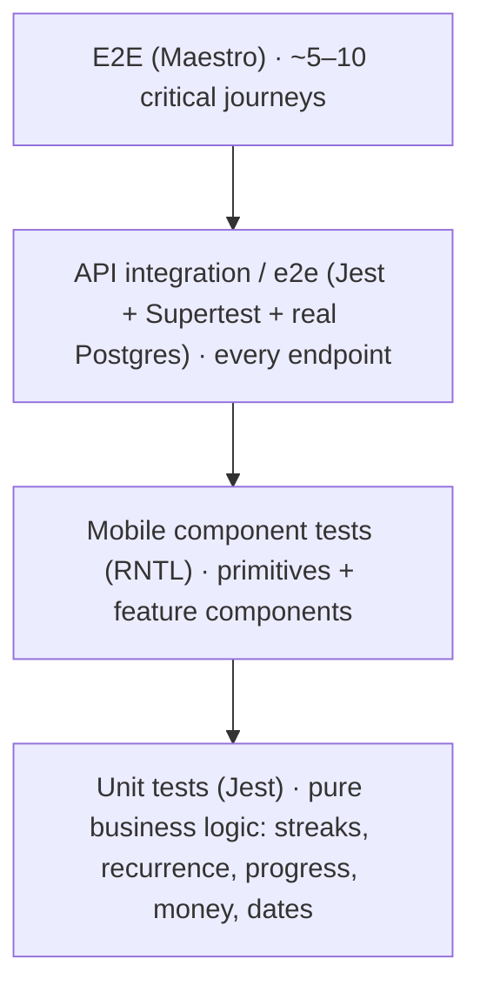

# 09 — Testing Strategy

| | |
|---|---|
| **Purpose** | What we test, how, where, and the gates that block a merge or release |
| **Status** | Draft v0.1 (Proposed) |
| **Last updated** | 2026-11-03 |
| **Related** | [02-Requirements](02-FUNCTIONAL-REQUIREMENTS.md) · [08-Roadmap](08-DEVELOPMENT-ROADMAP.md) · [10-Deployment](10-DEPLOYMENT-STRATEGY.md) |

---

## 1. Test pyramid

**Philosophy:** test *behaviour*, not implementation. Most bugs in Life OS will come from **dates, streaks, recurrence and authorization**, so most of the test effort goes there.

## 2. Layers

### 2.1 Unit tests (API + shared)
- **Tool:** Vitest (the NestJS 12 default; same `describe`/`it`/`expect` API as Jest). See ADR-017.
- **Targets:** pure functions extracted from services:
  - `computeStreak(schedules, completions, today, tz)`
  - `nextOccurrence(rule, fromDate)`
  - `goalProgress(goal)`
  - `toLocalDate(instant, tz)`, `money.format/parse`
- **Technique:** table-driven tests (`it.each`) for edge-case matrices.
- **Example matrix (streaks):**

| Case | Frequency | Completions | Today | Expected current |
|---|---|---|---|---|
| Fresh | DAILY | — | Mon | 0 |
| Today not yet done | DAILY | Sat, Sun | Mon | 2 |
| Missed yesterday | DAILY | Sat | Mon | 0 |
| Skip non-scheduled | WEEKLY_DAYS Mon/Wed/Fri | Mon, Wed | Fri (not yet) | 2 |
| Weekly target | 3×/week | 3 last week, 1 this week | Thu | 1 (weeks) |
| Schedule changed | DAILY → Mon/Wed | … | … | old rule applies to old dates |
| DST spring-forward | DAILY, `Europe/London` | 30 & 31 Mar | 31 Mar | 2 |
| TZ change | DAILY, Dar → London | localDates unchanged | | no recompute |

### 2.2 Service tests with mocks (API)
- `Test.createTestingModule` with a mocked `PrismaService` **only** for orchestration logic (e.g. "emits `habit.completed`"). Prefer the integration tests below for anything touching queries.

### 2.3 API integration / e2e tests
- **Tool:** Vitest + Supertest against a real Nest app (`createTestApp()`) and **real PostgreSQL** (Docker service in CI). Built in 4.3:
  - `test/global-setup.ts` runs once before all files: refuses any database whose name doesn't end in `_test`, then applies migrations (`prisma migrate deploy`) to `DATABASE_URL_TEST`.
  - `resetDatabase(prisma)` (`test/utils/test-db.ts`) truncates every table except `_prisma_migrations` in a `beforeEach`, so **each test starts empty**. Before deleting anything it requires `NODE_ENV=test` and re-checks the database name with Postgres, inside the same transaction as the `TRUNCATE` (so the check and the delete use the same connection).
  - Emails: e2e tests send real SMTP to **Mailpit** (docker-compose locally, a service container in CI) and read them back through its HTTP API (`test/utils/mailpit.ts`: `clearInbox`, `waitForEmails`, `tokenFromEmail`).
  - Files run one at a time (`fileParallelism: false`) because they share one database. Fast enough for now; if the suite gets slow, switch to one schema per worker.
- **Coverage requirement:** every endpoint has at least one happy path, one validation failure, one auth failure (no token → 401), and one **cross-user** test (user B gets 404 for user A's resource).
- Factories (`test/factories.ts`) create users/tasks/habits with valid, unique defaults; a test passes only the fields it cares about. No shared global fixtures. (4.3: `createUser`.)

### 2.4 Mobile component tests
- **Tools:** Jest (`jest-expo` preset) + React Native Testing Library + MSW (mocking `fetch`) *(Proposed)*. Set up in 5.1: `apps/mobile/jest.config.js`, tests next to the code as `*.test.tsx`, `renderWithTheme()` in `src/test/render.tsx`, `bun run --filter @life-os/mobile test` (also in CI).
- **RNTL 14 is async:** `await render(…)`, `await fireEvent.press(…)`. A missing `await` makes assertions run before rendering ("`render` function has not been called"); the type-aware `no-floating-promises` lint rule catches it.
- **No snapshot tests** (the roadmap mentioned them for 5.1): they fail on every harmless style change and get updated without being read. Tests assert roles, states and the specific token values instead.
- Query by role/label (`getByRole('button', { name: 'Save' })`), which also enforces accessibility labels.
- Targets: every UI primitive's states, forms (validation messages), optimistic update + rollback, auth gate redirects.

### 2.5 End-to-end
- **Tool:** **Maestro** *(Proposed. Simpler YAML flows than Detox, works with Expo dev builds)*.
- Runs against a staging-like API with a seeded DB.
- Critical journeys:
  1. Register → onboarding → Today.
  2. Create task → complete → appears in history.
  3. Create habit → check in → streak 1 → undo → streak 0.
  4. Create goal with milestones → complete milestone → progress updates.
  5. Logout → login → data still there.
  6. Delete account.

### 2.6 Non-functional testing
| Type | Approach | When |
|---|---|---|
| Security | ASVS L1 checklist, cross-user tests, `osv-scanner`, rate-limit tests, manual token-reuse test | Phase 10 + each release |
| Performance | `autocannon`/`k6` on `/today` and `/tasks` with a seeded 1-year dataset; `EXPLAIN ANALYZE` on hot queries; React Native perf monitor / Flashlight on Android | Phase 10 |
| Accessibility | RNTL role queries (continuous); manual VoiceOver + TalkBack script; contrast check script for tokens | Each release |
| Theme consistency | Component stories rendered in both themes (snapshot or visual review) | Each UI PR |
| Migrations | CI applies all migrations to an empty DB **and** to a DB restored from the last release's schema | Each PR touching `prisma/` |
| Backups | Restore latest dump into a scratch container and run a smoke query | Monthly |

## 3. Coverage targets
| Area | Target |
|---|---|
| `packages/shared` pure logic | ≥ 95% lines |
| API `*.service.ts` + pure helpers | ≥ 80% lines |
| API endpoints | 100% of endpoints have e2e tests (tracked by a checklist, not %) |
| Mobile | Every `components/ui` primitive + every form. % is not enforced |

Coverage is a smoke alarm, not a goal. A PR that lowers coverage needs a reason.

## 4. CI gates
| Gate | PR to `main` | Release tag |
|---|:-:|:-:|
| Lint + Prettier check | ✅ | ✅ |
| `tsc --noEmit` (all workspaces) | ✅ | ✅ |
| Unit + component tests | ✅ | ✅ |
| API e2e with Postgres service | ✅ | ✅ |
| Migration apply check | ✅ (if prisma changed) | ✅ |
| OpenAPI diff artifact | ✅ | |
| Maestro E2E (Android emulator) | nightly | ✅ |
| Dependency vulnerability scan | ✅ (warn) | ✅ (block high) |

## 5. Bug workflow
1. Reproduce → write a **failing test** first.
2. Fix → the test passes.
3. Log root cause + lesson in [12-LEARNING-LOG](12-LEARNING-LOG.md).
