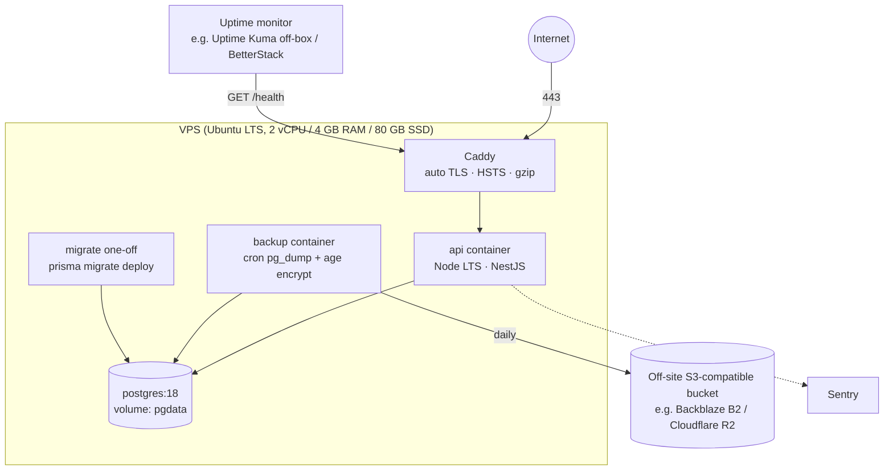
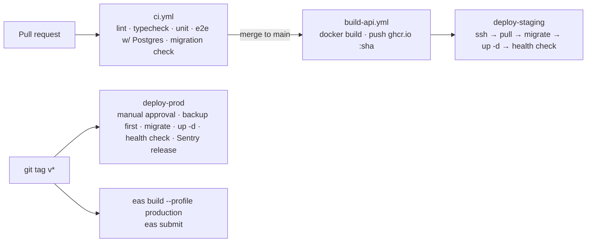

# 10 — Deployment Strategy (Self-Hosted)

| | |
|---|---|
| **Purpose** | How Life OS is built, shipped, hosted, backed up and monitored on our own VPS, and released to the stores |
| **Status** | Draft v0.1. Hosting model **Confirmed** (ADR-008); specifics Proposed |
| **Last updated** | 2026-11-03 |
| **Related** | [04-Architecture](04-SYSTEM-ARCHITECTURE.md) · [09-Testing](09-TESTING-STRATEGY.md) · [11-Decisions](11-TECHNICAL-DECISIONS.md) |

---

## 1. Environments

| Env | Where | API URL | DB | Mobile build | Purpose |
|---|---|---|---|---|---|
| local | Laptop | `http://<LAN-IP>:3000` | Docker Postgres | Expo dev build | Development |
| test (CI) | GitHub Actions | ephemeral | Postgres service container | — | Automated tests |
| staging | VPS (same box, separate Compose project + DB) *or* a 2nd small VPS | `https://staging-api.<domain>` | `lifeos_staging` | EAS `preview` (internal distribution) | Pre-release verification |
| production | VPS | `https://api.<domain>` | `lifeos_prod` | EAS `production` (stores) | Real users |

**Proposed:** start with staging + prod on **one VPS** (separate Compose projects, networks and DBs) to save cost. Split onto separate machines once there are real users.

## 2. Production topology



**Sizing note:** 2 vCPU / 4 GB is plenty for thousands of users of a personal app. Postgres is the main memory consumer (tune `shared_buffers` ≈ 1 GB).

### docker-compose.prod.yml (shape)
```yaml
services:
  caddy:
    image: caddy:2
    ports: ["80:80", "443:443"]
    volumes: [./Caddyfile:/etc/caddy/Caddyfile, caddy_data:/data]
    depends_on: [api]
  api:
    image: ghcr.io/tina-codertz/life-os-api:${API_TAG}
    env_file: .env.prod            # on server only, chmod 600
    expose: ["3000"]               # NOT published to host
    healthcheck: { test: ["CMD", "wget", "-qO-", "http://localhost:3000/api/v1/health"], interval: 30s }
    restart: unless-stopped
  postgres:
    image: postgres:18
    volumes: [pgdata:/var/lib/postgresql]   # Postgres 18+ path
    environment: { POSTGRES_DB: lifeos_prod, POSTGRES_USER: lifeos, POSTGRES_PASSWORD_FILE: /run/secrets/pg_password }
    restart: unless-stopped        # no ports exposed
  backup:
    image: <small image with pg_dump + rclone + age>
    # cron: 02:30 daily
volumes: { pgdata: {}, caddy_data: {} }
```

## 3. Server hardening checklist
- [ ] Non-root deploy user; SSH key auth only; `PasswordAuthentication no`; `PermitRootLogin no`.
- [ ] UFW: allow 22 (optionally restricted to your IP), 80, 443. Deny everything else.
- [ ] `unattended-upgrades` for security patches; reboot window documented.
- [ ] `fail2ban` for SSH.
- [ ] Docker log rotation (`max-size: 10m`, `max-file: 3`).
- [ ] Postgres has no host port; reachable only on the Compose network.
- [ ] `.env.prod` and secrets readable only by the deploy user. Never in git or CI logs.
- [ ] `SMTP_URL` from the email provider (contains a password: a secret), `MAIL_FROM` on a domain with SPF/DKIM set up, `EMAIL_LINK_BASE_URL` pointing at links the app opens.
- [ ] `JWT_ACCESS_SECRET` generated on the server (`openssl rand -base64 48`), different from every other environment. Rotating it logs every user out of their current access token (they refresh after 4.5).
- [ ] Time sync (`chrony`). The server runs in UTC.

## 4. CI/CD (GitHub Actions)



**Deploy script steps (on the server, invoked via SSH action):**
1. `docker compose pull api`
2. **Take a pre-migration backup** (`pg_dump` → local + off-site).
3. `docker compose run --rm api bunx prisma migrate deploy` *(or `npx`; the image runs Node)*.
4. `docker compose up -d api`
5. Poll `/health` for 60 s → on failure, roll back to the previous image tag (`API_TAG` from the last good deploy).

**Secrets in GitHub:** `SSH_HOST`, `SSH_USER`, `SSH_KEY`, `GHCR_TOKEN`, `EXPO_TOKEN`, `SENTRY_AUTH_TOKEN`. Environment protection rules require approval for `production`.

## 5. Backups & disaster recovery
| Item | Policy |
|---|---|
| Frequency | Nightly full `pg_dump -Fc` + pre-deploy dump |
| Encryption | `age` public key on server; private key stored offline (password manager) |
| Retention | 7 daily, 4 weekly, 6 monthly (rclone + lifecycle rules) |
| Off-site | S3-compatible bucket in a different provider/region |
| Restore drill | **Monthly:** restore the latest dump into a scratch container, run row-count + smoke queries, record the date in the learning log |
| RPO / RTO targets | RPO ≤ 24 h (≤ 1 h later with WAL archiving via `pgBackRest`, v1.1+); RTO ≤ 4 h |
| VPS loss | Runbook: new VPS → bootstrap script → restore dump → DNS switch |

## 6. Monitoring & observability
| Signal | Tool (Proposed) |
|---|---|
| Uptime | External monitor hitting `/health` every 1 min, alerts by email/Telegram |
| API errors | Sentry (NestJS SDK), PII scrubbing, release tagging |
| Mobile crashes | Sentry (`@sentry/react-native`) with source maps uploaded from EAS |
| Logs | JSON logs via Docker → `docker logs`; later Loki + Grafana if needed |
| Host metrics | `node_exporter` + Grafana Cloud free tier *or* Netdata (later) |
| DB | `pg_stat_statements` enabled; weekly review of slow queries |
| Disk | Alert at 80% usage (backups and logs fill disks) |

## 7. Mobile builds & store release
| Item | Plan |
|---|---|
| Build service | **EAS Build** (cloud). Self-hosting doesn't need to cover builds; it's about the backend |
| Profiles | `development` (dev client), `preview` (internal APK/TestFlight → staging API), `production` (stores → prod API) |
| Config | `app.config.ts` reads `APP_ENV` → `extra.apiUrl`. Never put secrets in app config (it's public) |
| OTA updates | `expo-updates` with channels per profile. JS-only fixes ship OTA; native changes need a store build |
| Versioning | SemVer `1.0.0`; `runtimeVersion` policy `appVersion`; build numbers auto-incremented by EAS |
| iOS | Apple Developer Program ($99/yr), App Store Connect, TestFlight beta |
| Android | Google Play Console ($25 one-time), internal → closed → production tracks. New personal accounts must run a closed test (12+ testers, 14 days) before production, so **plan for this in week 24** |
| Store requirements | Privacy policy URL, in-app account deletion, data safety form / privacy nutrition labels, screenshots for both themes, support URL/email |

## 8. Production launch checklist
- [ ] Domain + DNS (A record for `api.` and `staging-api.`), TLS verified.
- [ ] All Phase 10 gates passed.
- [ ] Backup + **successful restore drill** completed.
- [ ] Sentry receiving events from API and both mobile platforms.
- [ ] Uptime monitor and alerts tested (stop the API, receive the alert).
- [ ] Rate limits verified in production config.
- [ ] Swagger off in prod (automatic with `NODE_ENV=production`; e2e test proves the 404).
- [ ] `TRUST_PROXY_HOPS=1` (Caddy in front). Without it every request looks like it comes from Caddy and all users share one rate-limit bucket; set too high and clients can fake their IP.
- [ ] One API instance, or move rate-limit counters to Redis (they're in memory).
- [ ] Privacy policy + terms published.
- [ ] Support email set up.
- [ ] Runbook written: deploy, rollback, restore, rotate secrets, revoke all sessions.

## 9. Cost estimate (monthly, Proposed)
| Item | ~USD |
|---|---|
| VPS 2 vCPU / 4 GB (Hetzner/DigitalOcean) | 5–24 |
| Off-site backup storage (<10 GB) | < 1 |
| Transactional email (free tier) | 0 |
| Sentry (free tier) | 0 |
| Domain | ~1 |
| Apple Developer | ~8 (99/yr) |
| **Total** | **~15–35** |
